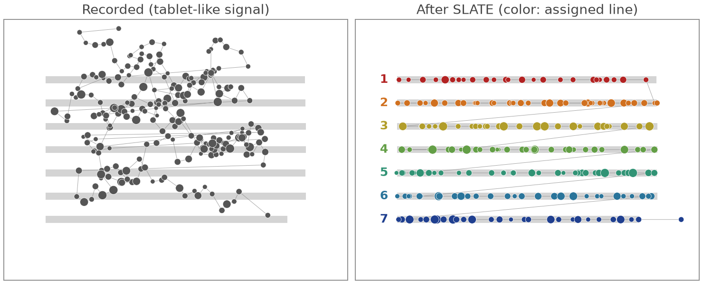

SLATE: Sequential Line Assignment with trial-adaptive thresholds for Tablet Eye tracking
========================================================================================

This repository contains the code for our paper on assigning gaze to lines of text when reading is recorded with the front camera of a tablet.

With a tablet camera, the vertical error of the gaze estimate is about as large as the line spacing, so the vertical coordinate cannot tell which line is being read. SLATE finds the line transitions in the horizontal coordinate instead: a return sweep is a large leftward move, and the threshold for "large" is set from the horizontal range of each trial. If the reading was recorded aloud, the speech can be used to recover transitions that the gaze signal missed. After the lines are assigned, the horizontal coordinate is recalibrated line by line.

If you want to use SLATE on your own recordings, the `slate/` directory is all you need (see [Using SLATE](#using-slate)). If you want to replicate the analyses reported in the paper, see [Replication of the analyses](#replication-of-the-analyses).


Try it
------

[`examples/demo.ipynb`](examples/demo.ipynb) walks through SLATE on one recording of the public ETDD70 dataset, a child reading a seven-line text aloud. The notebook shows its results when opened on GitHub, and you can run it after [installing](#installation).

The recording is first given the errors we measured in tablet-camera gaze. Assigning each fixation to the nearest text line, which is right for 99% of the fixations in the recording as published, is then right for 20%. SLATE, which only uses the horizontal coordinate, assigns 99% correctly in both. Below is the degraded recording as recorded and after SLATE (each fixation on its assigned line, at its recalibrated horizontal position). The notebook also replays the reading before and after.



The same example runs from the command line with `python -m examples.demo`.


Structure of this repository
----------------------------

- `slate/`: The method. `correction.py` returns the line and corrected position of each fixation in one call. `detector.py` detects the line transitions and assigns lines, `speech.py` (with `speech_activity.py`, `speech_alignment.py` and `audio.py`) adds the speech-based step, and `recalibration.py` recalibrates the horizontal coordinate.

- `baselines/`: The thirteen comparison algorithms. `carr_drift.py` and `confla_algorithms.py` are third-party code (see `THIRD_PARTY_NOTICES.md`), and `carr.py` and `confla.py` call them.

- `analysis/`: The code used to evaluate the methods.

	- `scoring.py`: Matching of detected and reference line transitions (precision, recall, F1).

	- `public/`: Everything that runs on the two public oral-reading datasets: the loaders, the tablet-like degradation, and the scripts that produce Table 3 and the values of Figure 9. `session_affine.csv` holds the gains and offsets measured in the tablet recordings, which the degradation draws from. It contains no participant identifiers.

	- `clinical/`: The evaluation on the clinical recordings (Tables 1 and 2). The recordings cannot be shared, so these scripts are here to be read rather than run.

- `stimuli/`: Text and word positions of the two passages read in the clinical recordings.

- `examples/`: The example above (`demo.ipynb`, `demo.py`) with one trial of the ETDD70 dataset.

- `tests/`: Short tests of the detection, the scoring and the degradation.

- `data/README.md`: Where the scripts expect the data to be.


Installation
------------

Clone or download the repository and `cd` into the top-level directory. You will probably want to create and activate a new Python virtual environment:

```shell
python3 -m venv .venv
source .venv/bin/activate
```

To run the example or to use SLATE on gaze, any recent Python 3 with the current versions of these packages will do (SLATE itself only needs `numpy` and `pandas`, and `notebook` is for the example notebook):

```shell
pip install numpy pandas scipy scikit-learn matplotlib notebook
```

To replicate the analyses, install the versions we used, which require Python 3.11 or later and include the audio packages:

```shell
pip install -r requirements.txt
```

To check that everything works:

```shell
python -m tests.test_detector
python -m tests.test_scoring
python -m tests.test_degradation
```


Using SLATE
-----------

The detector takes the sample times in seconds and the horizontal gaze position in pixels. The vertical coordinate is not used.

```python
import pandas as pd
from slate import detect_line_transitions, assign_lines

# one recording: time in ms and horizontal gaze position in px, with reading starting after 4 s
rec = pd.read_csv("recording.csv")
t = rec.timeStamp.to_numpy(float) / 1000
keep = t >= 4.0
t, x = t[keep] - t[keep][0], rec.gazeScreenPointX.to_numpy(float)[keep]

# width of each text line in px, in reading order (optional)
line_widths = [765, 1274, 1336, 1247, 1079, 1340, 934, 1303, 1309, 1251]

transitions = detect_line_transitions(t, x, line_widths=line_widths)
lines = assign_lines(t, transitions, n_lines=len(line_widths))   # line of every sample
```

`transitions` holds the time at which each line starts, and `assign_lines` gives the line number of any set of times, for example the samples or the midpoints of your fixations. A few things to know:

- Time zero is the moment the text appears. Remove calibration samples and missing samples (NaN) before the call.

- The first transition is the entry onto line 1. On our tablet task, gaze starts near the screen center, so this entry is searched for in the first 4 s, and what comes before it is assigned to no line. If gaze is already on line 1 when the text appears, pass `first_at_start=True`.

- On our tablet task, gaze from before the reading starts is set aside by this first-line entry. Other tasks do not necessarily have such a start, and with `first_at_start=True` everything from time zero is taken as line 1. For such recordings we recommend leaving out the samples and fixations from before the reader starts on the text, especially when the horizontal recalibration is used, because they can otherwise be taken as the start of the first line.

- `line_widths` is optional. With it, the threshold is lowered after short lines and the number of transitions cannot exceed the number of lines.

- The sampling rate does not need to be constant or known. All settings are defined in seconds or relative to the horizontal range of the recording, and we used the same values for 30 Hz tablet recordings and for 250 Hz and 1000 Hz laboratory recordings.

If you have fixations, `correct_fixations` does the three steps in one call and returns one row per fixation. The recorded values are kept, and the line and the corrected position are added:

```python
from slate import correct_fixations

# fixations: array or table with one row per fixation: start (s), end (s), x (px), y (px)
# lines: one dict per text line, in reading order, with its left and right edge, its vertical
# position and its number of words
lines = [
    dict(left=239, right=1439, y=198.5, n_word=14),
    dict(left=239, right=1441, y=290.5, n_word=14),
    # and so on for every line of the text
]
table = correct_fixations(fixations, t, x, lines)
```

```
   start  end      x      y  line  x_corrected  y_corrected
0    0.0  0.3  577.1   -3.8     1        524.5        198.5
1    0.3  0.6  396.1   11.1     1        247.9        198.5
2    0.6  0.8  425.0   52.7     1        292.0        198.5
3    0.8  1.3  468.3   61.3     1        358.2        198.5
```

By default the end of each line is mapped to the right edge of the text line. Where the last fixation of a line falls depends on the reader, the text and the task, so this target is a parameter: `alpha` moves it inward, in widths of the last word of the line (`last_w` in `lines`).

If you have the audio of the reading, `slate.speech.supplement` revisits the stretches where more speech was produced than one line should take:

```python
from slate import speech
from slate.audio import load_audio
from slate.speech_activity import vad_segments

audio = load_audio("recording.m4a")                 # mono, 16 kHz, starting when the text appears
segs = vad_segments(audio, 16000)
transitions = speech.supplement(list(transitions), t, x, segs, widths=line_widths)
```

Word-level speech recognition can be added as a further cue (`slate/speech_alignment.py`, which needs `faster-whisper`), and `analysis/clinical/speech_cues.py` shows how we used it.

To recalibrate the horizontal coordinate of the samples rather than of fixations, use the same `lines`, numbered from 1:

```python
from slate.recalibration import line_parameters, recalibrate

numbered = [dict(line, idx=k) for k, line in enumerate(lines, 1)]
params = line_parameters(t, x, transitions, numbered)    # one row per line: gain and offset
x_corrected = recalibrate(t, x, transitions, params)
```

The start of each line is found with the character width of the text, `CHAR_PX` in `slate/recalibration.py`. It is set to that of our passages (33.7 px) and should be set to that of your text.

The docstrings of these functions describe the inputs in more detail.


Replication of the analyses
---------------------------

Table 3 and the comparison between the original and the tablet-like signal (Figure 9) use only public data, so you can reproduce them. Tables 1 and 2 need the clinical recordings, which contain voice and clinical information and cannot be shared.

To get the reported numbers exactly, use single-threaded numerical libraries:

```shell
export OMP_NUM_THREADS=1 MKL_NUM_THREADS=1 OPENBLAS_NUM_THREADS=1
```


### Results on the public datasets

The datasets are not redistributed here. Download them from their original sources and place them under `public_data/` (see `data/README.md` for the expected layout):

- ETDD70: https://doi.org/10.5281/zenodo.13332134

- Adedeji et al. (2022): https://osf.io/ym76z/, with the fixations and line labels from the DIST benchmark, https://osf.io/zt9gn/

Convert the datasets and run all methods on the original and the tablet-like signal:

```shell
python -m analysis.public.load_etdd70
python -m analysis.public.load_adedeji
python -m analysis.public.run --dataset etdd70 --corpus T4_Meaningful_Text --out outputs/public_etdd70
python -m analysis.public.run --dataset adedeji2022 --out outputs/public_adedeji2022
```

This writes one row per trial, signal condition and method. The second dataset takes a while, and `--nproc` sets the number of worker processes. To produce the tables:

```shell
python -m analysis.public.results \
    "ETDD70 T4=outputs/public_etdd70/rows.csv" \
    "Adedeji et al. (2022)=outputs/public_adedeji2022/rows.csv:aloud" --out outputs/public
```

This will output:

```
outputs/public/table3.csv
outputs/public/degradation.csv
```


### Results on the clinical recordings

The scripts that produced Tables 1 and 2 are in `analysis/clinical/`, and `data/README.md` lists what they read and the order in which we ran them.


License
-------

The original code is released under the MIT license (`LICENSE`). The third-party code keeps its own license (`THIRD_PARTY_NOTICES.md`).
